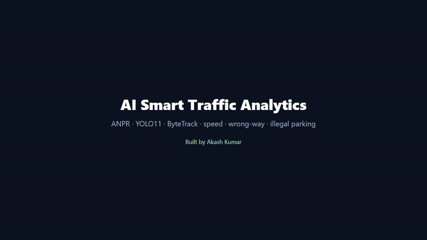
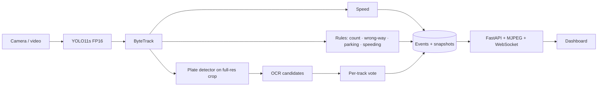

# AI Smart Traffic Analytics Platform: ANPR & Vehicle Analytics

**A production-style smart-city platform** that turns traffic cameras into live data: automatic number-plate recognition
(ANPR), vehicle detection and classification, ByteTrack multi-object tracking, speed estimation, and wrong-way,
illegal-parking and speeding detection, with evidence snapshots, a live dashboard and a FastAPI backend on an NVIDIA GPU.



▶ **Full demo video:** [`demo/demo.mp4`](demo/demo.mp4)

## What it does

| Capability | How |
|---|---|
| **Vehicle detection & classification** | YOLO11s (FP16) on frames resized to 1280 px: car, truck, bus, motorcycle |
| **Multi-object tracking** | **ByteTrack**: high- then low-confidence association keeps IDs through occlusion |
| **Speed estimation** | 4-point homography from image to a metric bird's-eye plane; speed over a ≥1 s window, only inside the calibrated road section |
| **Wrong-way detection** | Legal direction per carriageway relative to the road's vanishing point; 8 consecutive frames against it = critical alert |
| **Illegal parking** | Vehicle stationary ≥10 s inside a no-parking polygon (hard shoulder) |
| **Counting** | Per-class counts at a virtual line |
| **ANPR** | Plate detector **trained in this project** (YOLO11n, 99.0% mAP@50) on the full-resolution vehicle crop → RapidOCR |
| **OCR accuracy techniques** | **CLAHE** and **deskewing** as candidate views (best confidence wins), plausibility filter, and **per-character majority voting** across frames of the same tracked vehicle |
| **Evidence & search** | Snapshot with the vehicle boxed + plate crop for every event; partial-plate search across cameras; watchlist alerts |
| **Delivery** | **FastAPI** (REST, WebSocket, MJPEG live streams) on **NVIDIA GPU**, **Docker** image on `nvidia/cuda`, Next.js dashboard |

## Results (measured on an RTX 4060 Laptop GPU)

**Plate detection and ANPR**

| What | Result | Data |
|---|---|---|
| Plate detector mAP@50 / mAP@50-95 | **99.0% / 71.2%** (precision 99.6%, recall 97.6%) | held-out test split, 882 images |
| Plate detection recall on **unseen** data | **95.5%** (precision 89.0%) | OpenALPR benchmark, 330 US + EU images |
| OCR exact match on plate crops | **77.9%** (raw crop 77.0%) | same 330 plates, ground-truth text |
| Multi-frame **voting** (5 frames) | **70.9%** vs 57.8% single frame (+13.1 pts) | frames simulated from the stills (scale, blur, light, rotation, JPEG) |
| End-to-end ANPR (detector + OCR, exact plate) | **54.5%** | 330 unseen images |
| Detector / OCR latency | 18.4 ms per image · 10.1 ms per plate | |

**OCR preprocessing ablation** (why the pipeline uses *candidates* instead of always preprocessing):

| Variant | Clean crops | Degraded crops |
|---|---|---|
| raw | 77.0% | 57.0% |
| + padding | 71.5% | 50.3% |
| + CLAHE | 74.2% | 53.0% |
| + deskew | 76.4% | 57.0% |
| best confidence of raw / deskew / CLAHE+deskew (**used**) | **77.9%** | **57.9%** |

Also tested and **rejected**: cropping the blue EU band (EU 81.5% → 78.7%, US 76.1% → 62.6%).

**Traffic rules on video**

| What | Result |
|---|---|
| Wrong-way detection | **5/5** moving vehicles flagged in the simulated (time-reversed) segment |
| Illegal parking | flagged at **10.0 s** (= configured threshold) on the simulated parked car |
| False alarms on real highway footage | **0** wrong-way, **0** illegal parking |
| Speed on a 130 km/h motorway | median 120 km/h (p10 84, p90 138), approximate calibration |

**Speed** (4K frames from `vehicles.mp4`)

| Configuration | ms / frame | FPS |
|---|---|---|
| YOLO11s @1280 FP16, GPU | 23.8 | **42.0** |
| YOLO11s @1280 FP32, GPU | 34.1 | 29.3 |
| YOLO11s @640 FP16, GPU | 12.5 | 80.3 |
| YOLO11n @1280 FP16, GPU | 16.9 | 59.2 |
| YOLO11s @1280 FP32, CPU | 211.4 | 4.7 |
| Full pipeline (detect + track + speed + rules + ANPR) | 22.7 (median) | 9.7 incl. 4K decode, single process |

Live, the API runs **3 camera feeds at once** (two 4K, one 1080p) on the one laptop GPU at ~8 FPS each, skipping
frames to stay real-time.

Raw results: [`backend/eval/results/`](backend/eval/results), [`models/plate_detector_metrics.json`](models/plate_detector_metrics.json),
training curves in [`docs/plate_training/`](docs/plate_training). Every number above is produced by a script in this repo.

## Architecture



Details: [docs/architecture.md](docs/architecture.md).

## Quick start

Needs an NVIDIA GPU, Python 3.11 and Node 22.

```bat
pip install torch --index-url https://download.pytorch.org/whl/cu128
pip install -r requirements.txt
run_demo.bat
```

It downloads the public videos and datasets, builds the simulated incident clip, starts the API with three camera
pipelines on :8400 and opens the dashboard on :3400.

```bash
python data/download_data.py && python data/prepare_plates.py   # data
python models/train_plate_detector.py --epochs 25               # retrain the plate detector (~36 min on an RTX 4060)
python backend/eval/eval_anpr.py                                 # ANPR + OCR evaluation
python backend/eval/ablate_preprocess.py                         # OCR preprocessing ablation
python backend/eval/eval_rules.py                                # rules on real + simulated video
python backend/eval/bench_fps.py                                 # inference speed
uvicorn app.main:app --app-dir backend --port 8400               # API + live pipelines
```

**Docker:** `docker compose up --build` (GPU via the NVIDIA container toolkit). Written and syntax-checked, not run on
the development laptop, which has no Docker. Cameras are configured in [`cameras.json`](cameras.json): any video file
or `rtsp://` URL, with calibration, zones and ANPR settings.

## Tests

```bash
python -m pytest tests --ignore=tests/e2e   # unit + API tests with stub models (no GPU needed)
python -m pytest tests/e2e                  # live pipeline + dashboard (Playwright), app must be running
```

## Data

Public data only; see [data/SOURCES.md](data/SOURCES.md). The plate dataset is CC BY 4.0; the OpenALPR benchmark is
used for evaluation only. The incident clip is **simulated** from the real highway video (time-reversed segment, a
car pasted on the hard shoulder) because real footage of these incidents is rarely available, and it is labelled as
such everywhere in the app.

## Limitations

* **Real-video ANPR is not ground-truthed.** On the 4K highway video, nearby plates are often read correctly
  (e.g. `NZ412GC`), but national plate layouts with emblems (Slovak, Czech) can add or swap characters. Country-specific
  plate-format rules and a recogniser fine-tuned on local plates would close most of the gap.
* Speed uses an approximate 4-point calibration from lane geometry, not a measured survey or radar ground truth.
* Wrong-way and illegal-parking detection rates come from simulated incidents.

## License

AGPL-3.0 (see [LICENSE](LICENSE)), because the project builds on Ultralytics YOLO11, which is AGPL-3.0. Closed-source
or commercial deployment needs an Ultralytics Enterprise licence, or a detector under a permissive licence.

---

Built by **Akash Kumar**: AI engineer for computer vision, edge AI, GenAI and AI agents.
Need this for your city or business? **akashkr19857@gmail.com** · [LinkedIn](https://www.linkedin.com/in/akash-kumar-883220192)
· [GitHub](https://github.com/akashkr19857)
