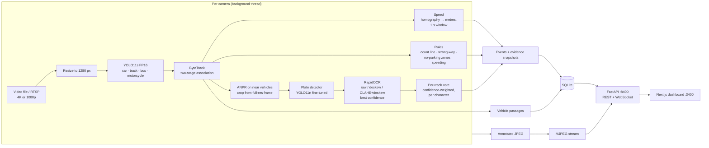

# Architecture

## How each feature works

| Feature | Method | Where |
|---|---|---|
| Vehicle detection & classification | YOLO11s (COCO) on frames resized to 1280 px, FP16, classes car/motorcycle/bus/truck | `vision/pipeline.py` |
| Multi-object tracking | ByteTrack (Ultralytics implementation): high-score detections matched first, low-score ones second to keep tracks through occlusion; 1.5 s lost-track buffer | `vision/tracking.py` |
| Speed estimation | 4-point homography from the image to a bird's-eye plane in metres (25 m × 250 m road section); speed = distance of the bottom-centre point over the last ≥1 s; reported as the track median | `vision/geometry.py` |
| Wrong-way detection | Each carriageway polygon has a legal direction relative to the road's vanishing point; a vehicle moving the opposite way for 8 consecutive frames raises a critical event | `pipeline.py`, `geometry.heading_sign` |
| Illegal parking | Vehicle anchor inside a no-parking polygon (hard shoulder) with < max(12 px, 8% of box height) movement for ≥ 10 s | `pipeline.py` |
| Counting | Sign change of the anchor point across a counting line, per class | `pipeline.py` |
| ANPR | Only for vehicles taller than a threshold (near the camera). Plate detector runs on the vehicle crop from the **full-resolution** frame; OCR on 3 candidates; up to 8 reads per track are voted per character | `anpr/ocr.py` |
| Evidence | Snapshot with the vehicle boxed + plate crop saved for every event | `runner.py` |
| Delivery | FastAPI: MJPEG live streams, REST for events/vehicles/plates/watchlist/analytics, WebSocket for live events and stats; Docker image on `nvidia/cuda` | `main.py`, `backend/Dockerfile` |

## Design decisions backed by measurements

* **OCR preprocessing is chosen per plate, not applied blindly.** On 330 labelled plates, padding cost 5.5 points
  and global CLAHE 2.8 points, because the recogniser already normalises its input. Reading raw / deskewed /
  CLAHE+deskewed candidates and keeping the most confident gave a small gain; the large gain comes from voting
  across frames (`backend/eval/ablate_preprocess.py`).
* **Detect on a downscaled frame, read plates on the full-resolution crop.** Vehicles are found at 1280 px for speed,
  but a 4K plate is ~110 px wide and readable only at native resolution.
* **One GPU, cameras take turns.** A single model set is shared behind a lock; when a feed falls behind real time
  the runner skips frames instead of building latency. Speeds use video timestamps, so skipped frames do not bias them.
* **Rules are tested on real and simulated footage.** Real highway video measures false alarms; a clearly labelled
  simulated clip (time-reversed segment, a car pasted on the shoulder) measures detection.
